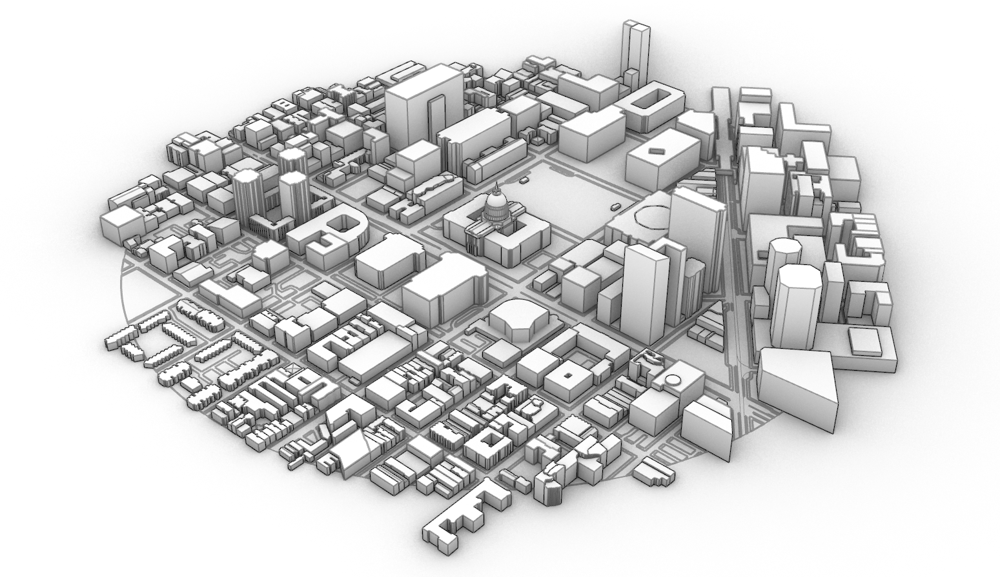
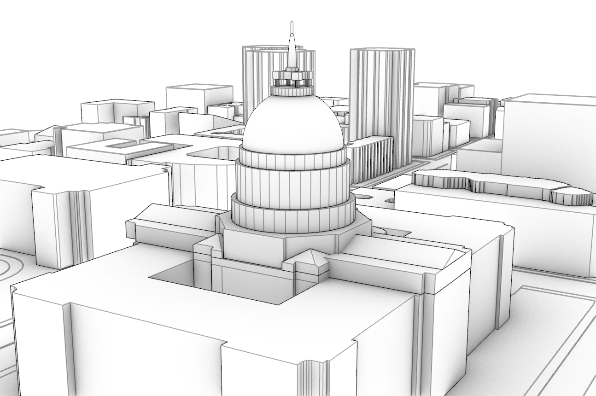
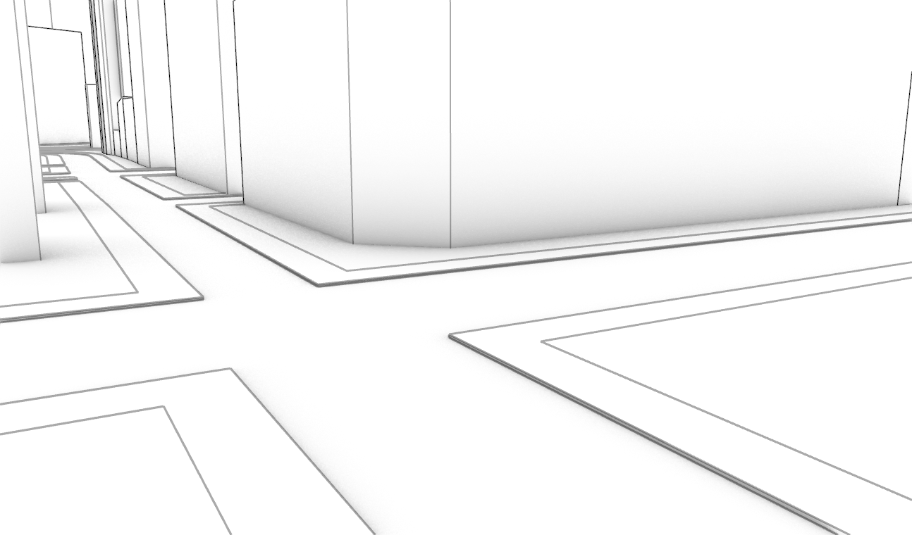
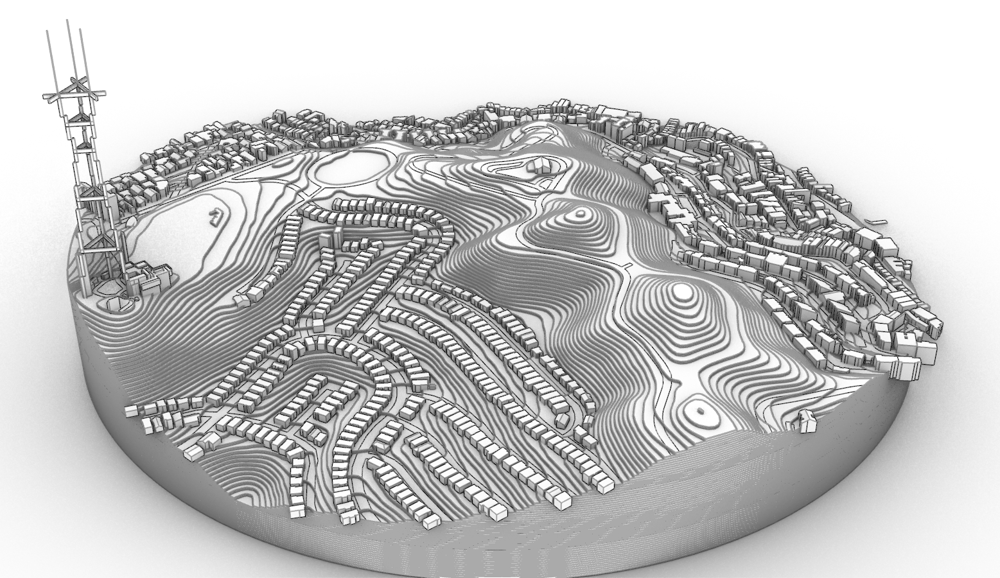
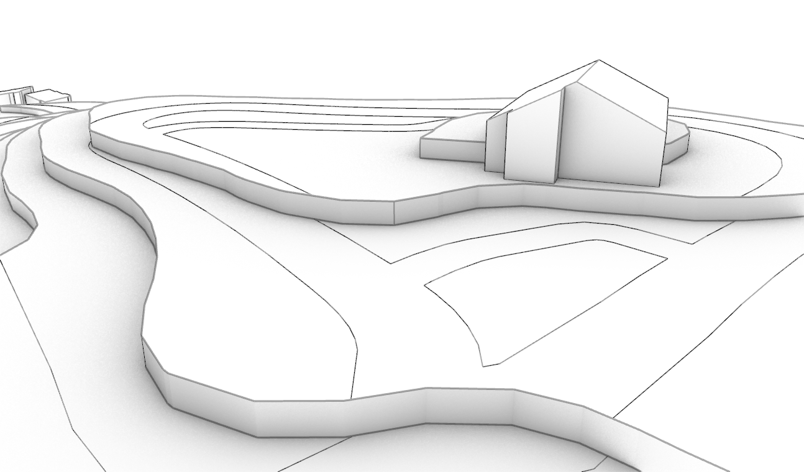

`Cityscape` is a plugin for Rhino 8 and later that builds an urban context model around any address or "lat, lon": buildings with their roofs, streets with curbs and sidewalks, raised rail and road decks, and the ground, either flat or as stacked terraces like a laser-cut contour model.
It uses open data only, needs no accounts or keys, and builds a site in a minute or two the first time, and in seconds after that.
It's free to use, but YMMV, and feedback is welcome.

## Goals

A context model is usually the first thing a site study needs and the last thing anyone wants to spend a day on.
`Cityscape` sets out to make one in a single command, close enough to use as it comes:

- **The best data there is for the site.** Buildings that mappers have modelled in 3D come out with their domes, towers and setbacks; the rest get heights and roofs measured from aerial LiDAR where it exists, and the map's own heights and roof shapes where it doesn't. Every building is labelled with where its shape came from.
- **Clean, light geometry.** Everything is a Rhino solid, surface or curve: walls are vertical, roofs and ground are planar (domes excepted), and there are no meshes, so the model can be cut, sectioned, drawn and fabricated like anything you'd model by hand.
- **Ready for drawings.** Each kind of object is on its own layer, with a colour and a print width, so a `Make2D` of the model is legible from the start.
- **Quick, and never stuck.** Downloads run side by side, a slow or failing source is dropped in seconds for the next best one, and the status bar and command line say what is happening. `Esc` stops it with what's built so far.

## What it builds

### Buildings

Each building is built from the best source it has:

1. **Mapped in 3D.** Many landmarks are mapped in OpenStreetMap as several parts, each with its own height, base height and roof shape. `Cityscape` builds each part: San Francisco City Hall comes out with its colonnaded drum, its dome and lantern, and its light courts.
2. **Measured by LiDAR.** In the US, the USGS 3DEP survey gives each roof's height and shape: flat, sloped, gabled or hipped, and a footprint covering several roofs (wings around a courtyard, a podium with a tower) is split into its parts. Where the map gives a roof shape the LiDAR fit doesn't make, such as a dome or a pyramid, the shape comes from the map and the heights from the LiDAR.
3. **The map's heights and roof shapes**, where there is no LiDAR: outside the US, or for buildings newer than the survey.
4. **The average building height of its neighbourhood**, from a worldwide satellite survey (about 90 m across), for a building with no height in the map.
5. **An 8 m box**, for a footprint with no height anywhere.

### Streets, sidewalks and the ground

On flat ground, the streets are one surface under the whole site, and the ground stands on it as 15 cm plates (a curb's height), so the curbs are the plates' edges.
Plates along streets that have sidewalks are sidewalks, in mid grey; the rest are green.
Bridges become decks at their measured heights, tunnels are left out, and rail lines are drawn along their tracks.

### Terraced contours

On a hill, the ground can be built as terraces instead: plates stepping up the slope at a fixed interval, as a contour model is cut from sheets of board.
Give the step (the thickness of your sheets), or leave it empty and `Cityscape` picks one from the site's steepness: 0.25 m on gentle ground, coarser on steep.
The streets are laid on the terrace tops, with their curbs as lines, and each building stands on its terrace at its true height.
Each terrace's edge is a smooth curve, so `Make2D` draws it as one clean line rather than a row of facets.
Terraces work anywhere: in the US from the LiDAR's ground, measured every metre or so; elsewhere from a worldwide satellite elevation model, one height every 30 m and accurate to a few metres, so outside the US the steps are at least 1 m and a narrow cut or embankment won't show.

### Circle or square

The site is a circle around the location, or a north-up square twice the radius across, to fill a sheet or a model base.

## Where the data comes from

`Cityscape` needs no keys or accounts: every source below is open and free to use.
The command line says which sources each run used, and every building carries a note of where its shape came from (the user text `cityscape.source`: `parts3d`, `lidar`, `tags`, `grid` or `default`).

- **Buildings, streets and rail: [Overture Maps](https://overturemaps.org)**, a monthly release of [OpenStreetMap](https://www.openstreetmap.org)'s buildings and streets with machine-learned footprints and heights where OpenStreetMap has none. If it hasn't arrived within 20 seconds, `Cityscape` fetches the same area from OpenStreetMap's own Overpass servers alongside, and uses whichever arrives complete first.
- **Heights, roofs and ground in the US: [USGS 3DEP](https://www.usgs.gov/3d-elevation-program) LiDAR.** Where several surveys cover a site, the newest is used, and a dense survey is read at a resolution that keeps the download to a minute or so.
- **Ground anywhere else: the [Copernicus DEM GLO-30](https://dataspace.copernicus.eu/explore-data/data-collections/copernicus-contributing-missions/collections-description/COP-DEM)**, the European Space Agency's worldwide elevation model, one height every 30 m. It measures the surface, roofs included, so where WSF3D shows large buildings they are taken out of it.
- **Heights anywhere else: [WSF3D](https://geoservice.dlr.de/web/datasets/wsf_3d)**, the German Aerospace Center's World Settlement Footprint 3D: the average building height of every 90 m cell in the world's settlements. It is coarse (a tall building among low ones comes out low), so it is used only where the map has no height; reading a site takes a few seconds.
- **Addresses: the US Census geocoder**, then **OpenStreetMap's Nominatim** for addresses anywhere else.

Downloads are kept on your computer, so a second run of the same site starts in seconds.

### Credits

These sources ask to be credited wherever their data is used, and a `Cityscape` model is built from them.
So each model lists the sources it used in its Notes (the `Notes` command), below anything you have written there, and updates the list when it is rebuilt.
Keep the credits with the model, and with drawings or images you publish from it:

- © OpenStreetMap contributors, under the [Open Database License](https://www.openstreetmap.org/copyright); with Overture Maps, © OpenStreetMap contributors, Overture Maps Foundation.
- LiDAR: U.S. Geological Survey, 3D Elevation Program.
- Building heights: World Settlement Footprint 3D © DLR, under [CC BY 4.0](https://creativecommons.org/licenses/by/4.0/).
- Ground outside the US: produced using Copernicus WorldDEM-30 © DLR e.V. 2010-2014 and © Airbus Defence and Space GmbH 2014-2018 provided under COPERNICUS by the European Union and ESA; all rights reserved. The organisations in charge of the Copernicus programme by law or by delegation do not incur any liability for any use of the Copernicus WorldDEM-30.

`Cityscape` is not affiliated with or endorsed by any of these providers.

## Using it

### Installing

1. In Rhino, open the Package Manager (`PackageManager` command).
2. Search for `Cityscape` and install it.
3. Restart Rhino. The `Cityscape` command is then available. It installs the Python packages it needs the first time it runs.

### Making a model

1. Open a new model in the units you want (the site comes in at the right scale for them).
2. Run `Cityscape`.
3. Type an address or place, or "lat, lon", and set the options below.
4. Press `OK`, and wait for the model: the first run for a site downloads its data (a minute or two), later runs take seconds. `Esc` stops it.
5. The location is the model's origin, with X east and Y north.

Running it again clears and rebuilds the `Cityscape` layers, so put anything of your own on other layers.
For scripts and macros, `-Cityscape` takes the same options on the command line, with the address in double quotes:

    -Cityscape Radius=500 Shape=Circle Terrain=Terraced TerraceStep=0 CutBuildings=No "1 Dr Carlton B Goodlett Pl, San Francisco, CA"

### Options

Each option is remembered for the rest of the Rhino session; defaults are shown in brackets.

- **`Location`**: a street address or place, or "lat, lon".
- **`Radius`** `[500 m]`: 50 to 2000 m, in meters or feet.
- **`Shape`**: the site's outline.
  - `[Circle]`: a circle of the radius.
  - `Square`: a north-up square, twice the radius across.
- **`Terrain`**: the ground.
  - `[Flat]`: a flat street surface, with sidewalk and ground plates on it.
  - `Terraced`: terraced contours, with the streets laid on them. Outside the US, from a coarser elevation model (see below).
- **`TerraceStep`** `[automatic]`: the height of each terrace, in meters or feet (in the model's units on the command line). Leave it empty (or `0` on the command line) to have it picked from the slope. A fine step on a hilly site makes many terraces and takes a while; `Cityscape` says how long before it starts.
- **`CutBuildings`** `[No]`: cut the buildings' footprints out of the ground, so each stands on the street surface or on its terrace, rather than standing in the ground plates.

### The model's layers

Everything goes under one top-level layer, `Cityscape`.
Layers a run leaves empty (no rail on the site, say) are removed.

- **`Cityscape`**
  - **`Buildings`**: light grey, 0.5 mm.
  - **`Streets_Surface`**: the street surface. Dark grey, 0.25 mm.
  - **`Sidewalks`**: sidewalk plates (flat ground). Mid grey, 0.25 mm.
  - **`Ground`**: the other ground plates (flat ground), green, 0.25 mm; or the terraces, mid grey, 0.125 mm.
  - **`Streets_Curb`**: curb lines (terraced ground). Black, 0.25 mm.
  - **`Rail_Centerline`**: railway tracks. Purple, 0.25 mm.
  - **`Elevated_Decks`**: bridges and raised rail. Dark grey, 0.25 mm.

`Make2D` carries these widths into its drawing.

## Limits

- Roofs are simplified: flat, sloped, gabled, hipped, pyramidal or domed, with ridges along a building's long side. It is a context model, not a survey.
- The LiDAR is a few years old in most places, so a newer building takes its height from the map, or from the 90 m grid if the map has none.
- Outside the US there is no LiDAR, so buildings come from the map's heights or the 90 m grid, roofs are flat unless the map gives a shape, and terraces come from the 30 m elevation model (typically within 2 m of the true ground, sometimes 5 m or more).
- Everything depends on what mappers have mapped. If a building is missing or wrong, you can fix it in [OpenStreetMap](https://www.openstreetmap.org), for everyone.

Please email [hello@michalow.ski](mailto:hello@michalow.ski) with any questions or feedback.
